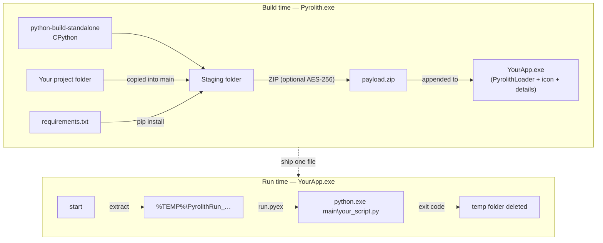

<div align="center">


# Pyrolith

**Pack a Python project into a single Windows `.exe` — with a complete, standalone CPython inside.**


[User guide](docs/user-guide.md) · [Architecture](docs/architecture.md) · [Building from source](docs/building.md) · [Changelog](CHANGELOG.md)

</div>

---

## Why Pyrolith?

Most packers ship either the *embeddable* Python distribution or a frozen subset of your imports. Both cut corners: no `tkinter`, no `pip`, no `venv`, missing modules discovered only at runtime.

Pyrolith takes a different route. Every executable carries a **full standalone CPython** from [python-build-standalone](https://github.com/astral-sh/python-build-standalone) — the same builds used by `uv` — so your code runs exactly as it does on a regular Python installation.

| | Embeddable Python / NuGet | Freezers (import analysis) | **Pyrolith** |
|---|:---:|:---:|:---:|
| Complete standard library | ⚠️ | ⚠️ only detected imports | ✅ |
| `tkinter`, `venv`, `ensurepip` | ❌ | ⚠️ | ✅ |
| Dynamic imports / plugins just work | ⚠️ | ⚠️ | ✅ |
| Dependencies from `requirements.txt` | ⚠️ manual | ✅ | ✅ |
| Single `.exe` | ❌ | ✅ | ✅ |

## Features

- **One file** — interpreter, your code and its dependencies in a single executable.
- **Any Python ≥ 3.11** published by python-build-standalone, **amd64** or **arm64**.
- **`requirements.txt` support** — packages are installed with `pip` into the bundled interpreter at build time.
- **Console or GUI apps** — `python.exe` with a console window, or `pythonw.exe` without one.
- **Optional AES-256 password protection** of the payload.
- **Custom icon and file details** (product name, description, author) shown in Explorer.
- **Command-line arguments and exit codes** are passed through to and from your script.
- **Project files** (`*.pyrolith`) to save and reload build settings.
- **Guard rails** — the GUI catches the usual mistakes (script outside the project folder, missing Python version, invalid icon, unwritable output…) before a build starts.

## How it works



The generated executable is just **PyrolithLoader** — a tiny Native AOT program — followed by a ZIP archive. On start it extracts the archive to a temporary folder, runs the command stored in `run.pyex`, waits for Python to exit and cleans up. Details in [docs/architecture.md](docs/architecture.md).

## Quick start

> Requires Windows 10/11 and the [.NET 10 Desktop Runtime](https://dotnet.microsoft.com/download/dotnet/10.0). An internet connection is needed during the build (Python is downloaded from GitHub).

1. Start **Pyrolith.exe**.
2. **Python Runtime** — open the *Version* list (it loads the available versions) and pick one; choose the architecture.
3. **Python Application** — select your project **folder**, then the **entry script** inside it (e.g. `main.py`). Optionally add `requirements.txt` and default arguments.
4. **Options** — tick *GUI app* for windowed programs (tkinter, PySide…), optionally set a password.
5. **Executable Details** — product name, description, author and an `.ico` icon (all optional).
6. Choose the **output `.exe`** and press **Build EXE**.

Save the settings with **Project → Save** (`Ctrl+S`) to rebuild later in one click.
The full walkthrough, including every validation message, is in the [user guide](docs/user-guide.md).

## Writing apps for Pyrolith

Your code runs from a temporary copy, which has a few practical consequences:

```python
import os, sys
from pathlib import Path

# Files you shipped with the app: resolve them relative to the script, not the working directory.
HERE = Path(__file__).resolve().parent
config = (HERE / "config.json").read_text()

# The real .exe the user started (sys.argv[0] points into %TEMP%).
exe_path = os.environ.get("PYROLITH_EXECUTABLE")  # None when run with a normal Python

# Anything written next to the script is deleted when the app exits.
# Persist user data somewhere permanent instead:
data_dir = Path(os.environ["LOCALAPPDATA"]) / "MyApp"
data_dir.mkdir(parents=True, exist_ok=True)

sys.exit(0)  # the exit code is returned by the .exe
```

- Arguments given to the `.exe` are appended after the default arguments configured in Pyrolith.
- `PYTHONHOME`, `PYTHONPATH` and the user site-packages of the target machine are ignored, so a locally installed Python cannot interfere.

## Limitations

- **Windows only.** The loader and the Python builds are Windows-specific.
- **Start-up time** — the payload is extracted on every start (typically a few seconds, more with large dependencies).
- **Size limits** — the payload must stay below 4 GB and 65,535 files (no Zip64).
- **Password protection is not DRM** — it protects the file at rest; while the app runs, its files are unencrypted in `%TEMP%`.
- The loader itself is built for the architecture chosen in `build.ps1` (x64 by default); on ARM64 Windows it runs under emulation and starts the native arm64 Python.
- Like most packers, the generated executables may be flagged by some antivirus heuristics.

## Building from source

```powershell
./build.ps1          # AOT-publishes the loader, embeds it, publishes Pyrolith.exe to artifacts\Pyrolith
```

Requires the .NET 10 SDK and the *Desktop development with C++* workload (for Native AOT). See [docs/building.md](docs/building.md).

## Credits

Pyrolith stands on the shoulders of these projects (also listed in the app under **Info → Third-Party Libraries**):

| Project | Used for | License |
|---|---|---|
| [Vestris.ResourceLib](https://github.com/resourcelib/resourcelib) | Writing icon and version info into the `.exe` | MIT |
| [DotNetZip](https://github.com/haf/DotNetZip.Semverd) | Creating the (AES-256) ZIP payload | Ms-PL |
| [SharpCompress](https://github.com/adamhathcock/sharpcompress) | Extracting the payload in the loader | MIT |
| [python-build-standalone](https://github.com/astral-sh/python-build-standalone) | Portable CPython builds | MPL-2.0 (CPython: PSF) |

See [THIRD-PARTY-NOTICES.md](THIRD-PARTY-NOTICES.md).

## License

[MIT](LICENSE)
